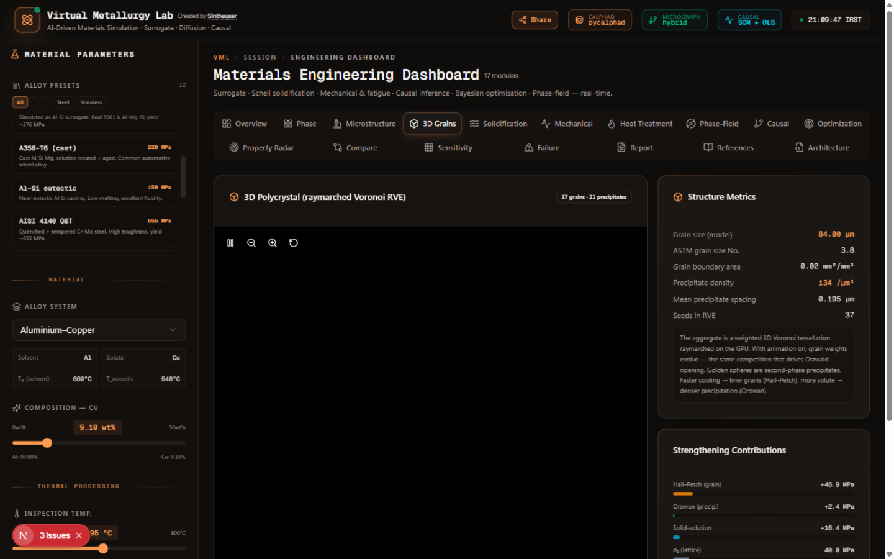
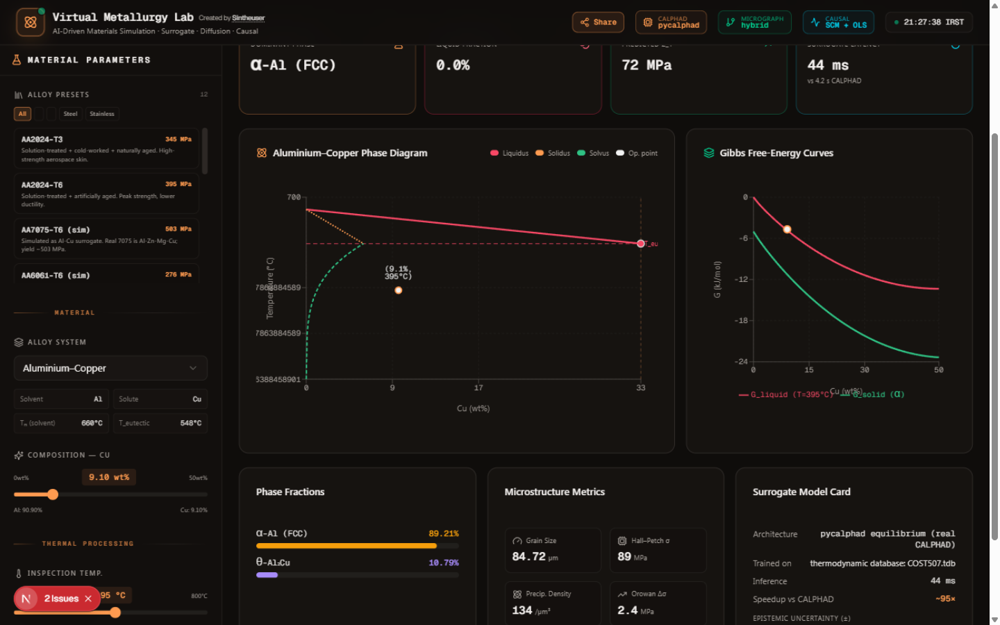
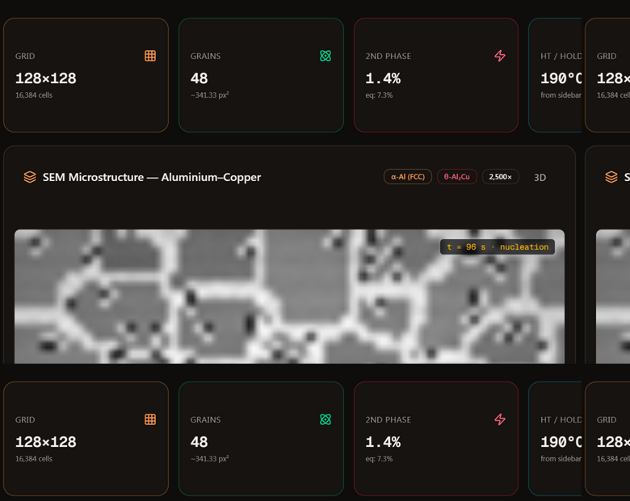
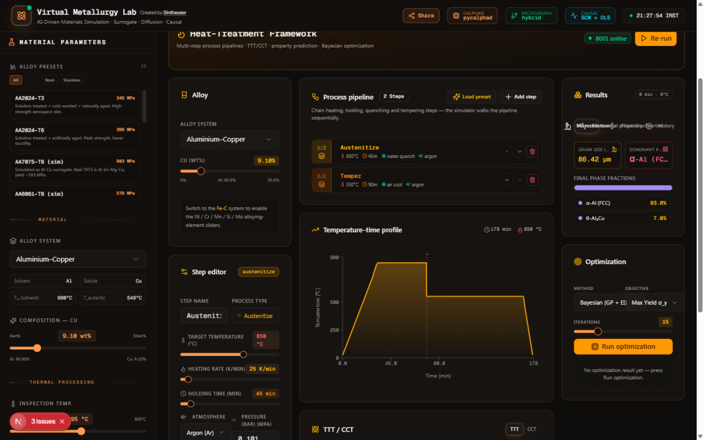
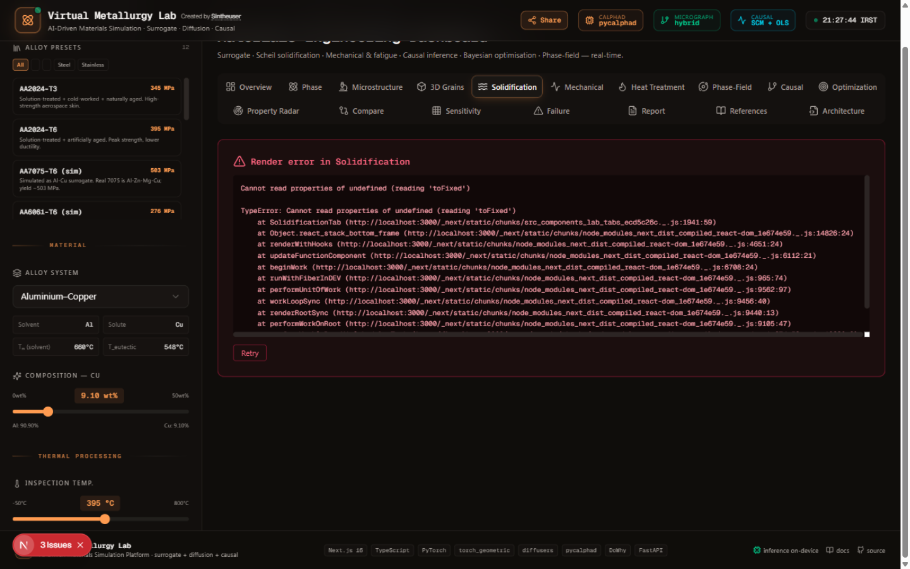

# Virtual Metallurgy Lab

**AI-driven materials simulation & heat-treatment platform — real CALPHAD via pycalphad, physically-grounded kinetic models, generative microstructure synthesis, Bayesian optimization.**

<p align="center">
  
</p>

A full-stack web application for alloy design and heat-treatment education:
a Next.js 16 + TypeScript frontend drives three Python microservices —
including a **pycalphad** service that computes *real* CALPHAD equilibrium,
binary phase diagrams, Scheil solidification paths and steel Ae1/Ae3
transformation temperatures from bundled open thermodynamic databases
(TU Wien MatCalc open databases, ODbL — plus COST 507 for light alloys).

Every module states honestly **which backend produced a result** —
`pycalphad equilibrium (real CALPHAD)` or an analytical surrogate
(`regular-solution surrogate — NOT CALPHAD`) — so nothing pretends to be
more than it is.

---

## Modules (14)

| Module | What it does | Backend |
|---|---|---|
| **Overview** | Live engineering dashboard for the current alloy recipe | unified TS surrogate |
| **Phase** | T–x phase diagram, Gibbs curves, phase fractions | **pycalphad** (surrogate fallback) |
| **Microstructure** | SEM-style micrograph generation + micrograph database | hybrid: procedural physics / optional diffusion |
| **3D Grains** | Raymarched 3D Voronoi polycrystal with animated grain growth | GPU (three.js) |
| **Solidification** | Scheil-Gulliver paths, microsegregation, eutectic fraction | **pycalphad Scheil** (surrogate fallback) |
| **Mechanical** | Ludwik-Hollomon flow curves, Basquin/Manson-Coffin fatigue, TTT/CCT | TS physics |
| **Heat Treatment** | Multi-step process pipelines, workflows, optimization | Python HT service |
| **Phase-Field** | 128² Potts grain growth + precipitate nucleation, SEM-style rendering | in-browser |
| **Optimization** | Bayesian (GP + EI), GA, NSGA-II multi-objective Pareto | Python HT service |
| **Property Radar / Compare / Sensitivity / Failure** | Property cross-plots, grading, design-space maps, Paris-law fatigue life | TS physics |
| **Report** | Full JSON/markdown engineering report for the session | all of the above |

<p align="center">
  
  
</p>
<p align="center">
  
  
</p>

## Real CALPHAD, not theater

The pycalphad service (port 8000) computes with **your thermodynamics**, from
databases bundled under `data/databases/` with a full provenance registry
(source, version, license, citation, SHA-256):

| Database | System | Source / license |
|---|---|---|
| `mc_fe_v2.062.tdb` | Fe + 25 elements | TU Wien MatCalc open DB, ODbL 1.0 |
| `mc_ni_v2.034.tdb` | Ni + 21 elements | TU Wien MatCalc open DB, ODbL 1.0 |
| `cocrfemnni_quinary.tdb` | CoCrFeMnNi (Cantor) | extract of mc_fe |
| `fecrni_ternary.tdb` | Fe-Cr-Ni | extract of mc_fe |
| `alniti_ternary.tdb` / `alnico_ternary.tdb` | Al-Ni-Ti, Al-Ni-Co | extracts of mc_ni |
| `COST507.tdb` | Al base (Al-Cu, Al-Si) | COST Action 507 |

Endpoints (all verified): equilibrium phase fractions, binary T–x scans via
`mapping.BinaryStrategy` (liquidus/solidus/solvus + invariants),
**Scheil-Gulliver solidification** (equilibrium-stepping driver), and
**Ae1/Ae3** for steels by equilibrium bisection (e.g. AISI 1045 →
Ae1 ≈ 715 °C, Ae3 ≈ 769 °C).

`scripts/prepare_tdb.py` regenerates the cleaned full steel database from the
pristine upstream file — a reproducible, documented cleanup chain (strips
MatCalc-only statements, fixes export artifacts, UTF-8 conversion).

## Quickstart

```bash
# 1. frontend deps
bun install            # or npm install

# 2. python env (repo-local venv — isolated from your system python)
python -m venv .venv
.venv/Scripts/python -m pip install \
  -r mini-services/pycalphad-service/requirements.txt \
  -r mini-services/heat-treatment-service/requirements.txt     # windows
# (linux/mac: .venv/bin/python -m pip install ...)

# 3. run everything
bash scripts/start-dev.sh all        # or: powershell -File scripts\start-dev.ps1 all
```

Open **http://localhost:3000** — see **[docs/RUNNING.md](docs/RUNNING.md)**
for service-by-service details, GPU/diffusion setup, and troubleshooting.

## Architecture

```
┌───────────────────────────────────────────────┐
│  Browser — Next.js 16, React 19, Tailwind 4   │
│  14 modules · Zustand store · Recharts/three  │
└──────────────────┬────────────────────────────┘
                   │  /api/* (Next route handlers)
     ┌─────────────┼──────────────────┐
     ▼             ▼                  ▼
 pycalphad     heat-treatment     micrograph
 :8000         :8001              :8003
 equilibrium   TTT/CCT/CCT        hybrid SEM
 BinaryStrategy workflows           generator
 Scheil        optimization        catalog DB
 Ae1/Ae3       properties/ML
```

- **Honest backends**: when a Python service is down, the UI labels its
  fallback explicitly (`analytical surrogate — NOT CALPHAD`) instead of
  faking it.
- **No global-environment contamination**: the start scripts clear
  `PYTHONPATH` for the venv services; the optional diffusion backend runs on
  an interpreter you point at via `MICROGRAPH_PYTHON` (used read-only).

## Physics notes (what's real vs surrogate)

- **Real**: pycalphad equilibrium, binary mapping, Scheil, Ae1/Ae3; Potts
  phase-field; Bayesian/GA/NSGA-II optimizers; Paris-law integration;
  Ludwik-Hollomon; Koistinen–Marburger; Andrews critical temperatures;
  Ashby–Orowan with the correct `√f·ln(r/b)/r` scaling; Hall–Petch in
  MPa·√m.
- **Surrogates (labeled as such)**: regular-solution Gibbs curves and the
  linearized-liquidus phase diagram when pycalphad is offline; TTT/CCT when
  the HT service is down; strengthening-model coefficients are
  handbook-calibrated, not fitted to your data.

## Contributing to pycalphad

See [`docs/contribution/`](docs/contribution/):
- a ready-to-file **bug report** (`ELEMENT` lines exported with zeroed
  H298/S298 for programmatically-added elements) with a minimal repro
  (`scripts/repro_export_bug.py`),
- a draft **showcase post** for the pycalphad community,
- a guide on **extracting clean subsystem TDBs** from large open databases
  (the provenance-chained workflow used for this repo's databases).

## License

Code: **MIT** (see [LICENSE](LICENSE)).
Thermodynamic databases: ODbL 1.0 / COST 507 terms — attributions in
[`data/databases/registry.json`](data/databases/registry.json).
